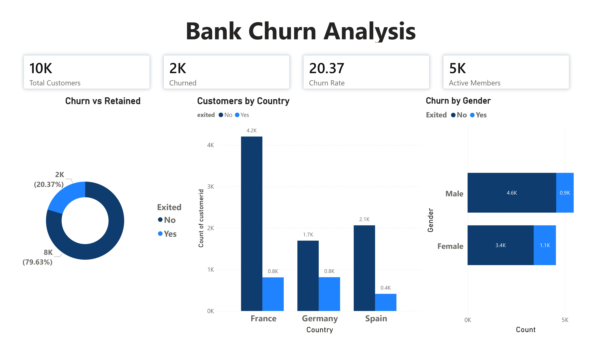
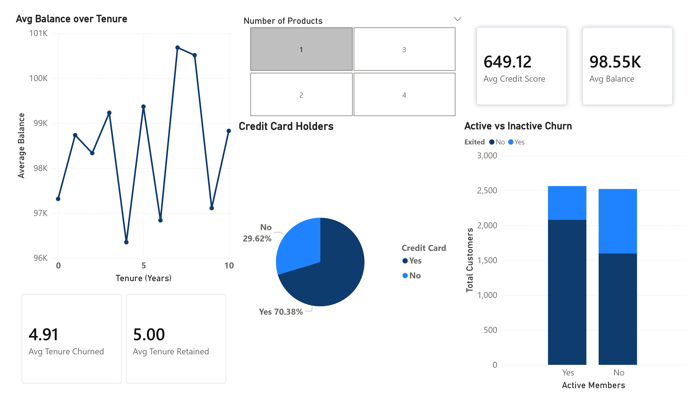

# Bank Customer Churn Analysis — Python, SQL, and Power BI

End to end analysis of 10,000 bank customers to identify churn drivers and
behavioral patterns using Python for data cleaning, MySQL for querying, and
Power BI for visualization.

---

## Dashboard




---

## Dataset

Source: [Kaggle — Churn Modelling Dataset](https://www.kaggle.com/)

10,000 customers across France, Spain, and Germany with 14 features including
credit score, age, balance, tenure, and churn status.

| Column | Description |
|---|---|
| creditscore | Credit score (350–850) |
| geography | Country: France, Spain, Germany |
| gender | Male / Female |
| age | Customer age |
| tenure | Years with the bank (0–10) |
| balance | Account balance |
| numofproducts | Number of bank products held (1–4) |
| hascrcard | Has credit card: Yes / No |
| isactivemember | Active member: Yes / No |
| estimatedsalary | Estimated annual salary |
| exited | Churned: Yes / No |

---

## Tools

| Tool | Purpose |
|---|---|
| Python (pandas) | Data cleaning and CSV export |
| Jupyter Notebook | Running the cleaning script |
| MySQL Workbench | SQL analysis and querying |
| Power BI Desktop | Dashboard and visualizations |

---

## Data Cleaning

Raw dataset had PascalCase column names and binary (0/1) values in HasCrCard,
IsActiveMember, and Exited columns. Cleaned using Python before importing to MySQL.

```python
import pandas as pd
df = pd.read_csv("Churn_Modelling.csv")

# lowercase all column names
df.columns = df.columns.str.lower()

# convert 0/1 to yes/no for readable columns
for col in ['hascrcard', 'isactivemember', 'exited']:
    df[col] = df[col].map({1: 'Yes', 0: 'No'})

df.to_csv("bank_crcard.csv", index=False)
```

Before vs after:

| Column | Before | After |
|---|---|---|
| Column names | HasCrCard, IsActiveMember | hascrcard, isactivemember |
| HasCrCard values | 1, 0 | Yes, No |
| Exited values | 1, 0 | Yes, No |

---

## Key Findings

### 1. 1 in 5 customers churned: Germany is the problem state
Overall churn rate is 20.37%. Germany has a significantly higher churn rate
than France and Spain despite having fewer total customers. The data does not establish the return on a particular retention campaign.

### 2. Inactive members churn at nearly double the rate of active members
Inactive members have a higher observed churn rate in this dataset. This comparison
does not establish causation or evaluate a predictive model.

### 3. Tenure alone does not predict churn
Average tenure for churned customers (4.91 years) is almost identical to retained
customers (5.00 years). Similar group averages alone do not establish whether tenure predicts churn
after accounting for other factors.

---

## SQL Analysis

16 queries covering churn rates by geography, gender, product count, credit score
buckets, and tenure comparison between churned and retained customers.

Sample query:
```sql
-- churn rate by number of products held
SELECT numofproducts,
COUNT(*) AS total_customers,
SUM(CASE WHEN exited = 'Yes' THEN 1 ELSE 0 END) AS churned,
ROUND(SUM(CASE WHEN exited = 'Yes' THEN 1 ELSE 0 END) * 100.0 / COUNT(*), 2) AS churn_rate
FROM bank_crcard
GROUP BY numofproducts
ORDER BY numofproducts;
```

Full query file: [bank_churn.sql](bank_churn.sql)

---

## Dashboard Overview

Page 1 — Customer Overview:
- KPI Cards: Total Customers (10K), Churned (2K), Churn Rate (20.37%), Active Members (5K)
- Churn vs retained donut chart
- Customers by country bar chart
- Churn by gender stacked bar

Page 2 — Churn Deep Dive:
- Avg balance over tenure line chart
- Credit card holders pie chart
- Active vs inactive churn stacked bar
- KPI Cards: Avg Credit Score (649), Avg Balance (98.55K), Avg Tenure Churned (4.91)
- Number of products slicer

---

## Files

```
├── Churn_Modelling.csv         (not included; required by the notebook)
├── bankcrcard.ipynb            
├── bank_crcard_fixed.csv       
├── bank_churn.sql              
├── churn_analysis.pbix         
└── README.md
```

---

## How to Run

1. Obtain the original `Churn_Modelling.csv`; its exact source listing is not recorded in this repository. The notebook currently reads it from `C:/Users/purav/Downloads/Churn_Modelling.csv`.
2. Review that path before running `bankcrcard.ipynb`. The notebook writes `bank_crcard.csv`; `bank_crcard_fixed.csv` is the separate cleaned CSV already included here.
3. Import the included cleaned CSV into MySQL and run `bank_churn.sql`.
4. Open `churn_analysis.pbix` in Power BI Desktop.

The raw-input notebook and MySQL workflow were not rerun in the latest audit because the original input and MySQL were unavailable. The included cleaned CSV contains 10,000 rows and 2,037 `Yes` churn labels (20.37%). Reproduce the count from this folder:

```powershell
python -c "import csv; r=list(csv.DictReader(open('bank_crcard_fixed.csv', encoding='utf-8-sig', newline=''))); n=sum(x['exited']=='Yes' for x in r); print(len(r), n, round(100*n/len(r), 2))"
```

The source and permission to redistribute the customer identifiers and surnames in the CSV require confirmation.

---

## Author

Purav Desai
B.Tech IT — Semester 6 | SCET, Surat

GitHub: [PuravDesai004](https://github.com/PuravDesai004)
LinkedIn: https://www.linkedin.com/in/puravdesai41
